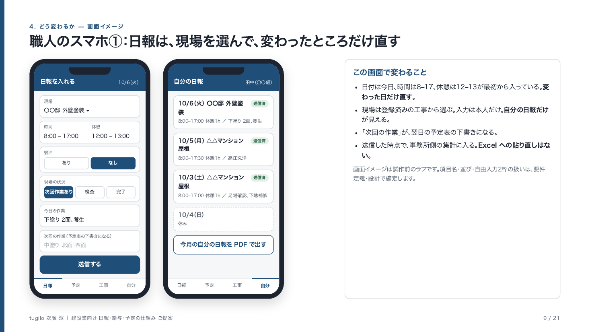
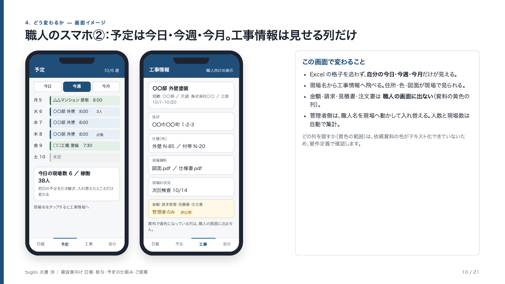
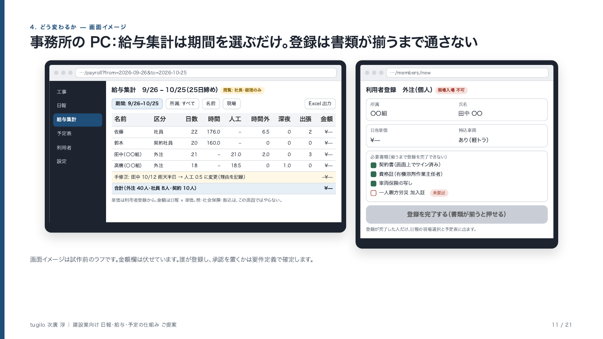

# 建設業向け 日報・給与・予定の仕組み ご提案

**提出:** tugilo 次廣 淳  
**作成:** 2026-10-04 22:20 JST  
**位置づけ:** 経営者の方が、目的・効果・費用を見て判断するための資料です。正式な契約額ではありません。お客様の正式社名は、この資料の時点では未記入です。  
**金額:** すべて **税別**。記載は **tugilo の開発費** です。杏那さん側（株式会社Andirich）の元請手数料は乗せていません（§6 に定義）。  
**内訳の表:** [概算見積](kimura_anna_construction_app_estimate_20261004.md)  
**プレゼン用:** [スライド HTML](kimura_anna_construction_proposal_slides_20261004.html) ／ [PDF](kimura_anna_construction_proposal_slides_20261004.pdf)（21枚。9〜11 ページに画面イメージ）  
**画面イメージ:** [images/](images/)（`kimura_anna_mock_*_20261004.png`、3 枚。試作前のラフ）

---

## 1. 目的

作るものの中心は、次の4つです。

1. **作業した本人が、その日の日報を入れる。** 事務所が LINE の文章を Excel に貼り直さない。
2. **その日報から、給与の集計が出る。** 社員・契約社員は時間、外注は人工。締めは25日、支払いは5日。社会保険や税金の計算は、この仕組みではやらない。
3. **予定が、今日・今週・今月で見える。** 職人が Excel の大きな表を追わなくてよい。
4. **書類が揃った人だけ、現場に入れる。** 資格証や契約書が欠けたまま入場しない。

見積書そのものは、いまお使いの見積ソフト（いただいた資料の表記では **みつもろう**）をそのまま使います。この提案は見積ソフトの作り直しではありません。

打合せで出た金額の目安は **300万円** です（上限として決まったものではありません）。要望を全部入れると、この金額には収まりません。打合せで決めたとおり、**マスト** と **あったらいいな** を分け（§3）、最初に何を残し、何をあと回しにするかを、この資料で選んでいただきます。

---

## 2. いま困っていること

伺っている規模は、事務所4人、管理4人、契約社員約10人、外注約40人、現場は約15です。

| 困っていること | いまのやり方 | 何が起きているか |
|----------------|--------------|------------------|
| 日報が散らばる | LINE で報告し、誰かが Excel に貼る | 貼り忘れ、貼り間違い、あとから探せない |
| 給与が手計算 | 給与ソフトは使っていない。イレギュラーが多い | 25日締めの集計が、人に依存する |
| 予定が Excel | 表を見て、人を入れ替える | 職人は「今日どこへ行くか」がすぐ分からない |
| 写真と資料が LINE とフォルダ | もらったものを共有フォルダへ移す | どの現場の、どの部位の写真か、目で分けている |
| 誰が現場に入れるか | 書類はフォルダと Excel | 書類が揃う前に動き出す余地がある |
| 連絡が LINE | 現場ごとにトーク | やめるには、LINE と同じ水準の連絡手段が要る |

---

## 3. マストと、あったらいいな

9月28日の打合せで、「必須を幹にして、あったらいいなはオプションに分ける」と決めました。いただいた依頼資料の「必要な機能」と「職人さん用アプリ」を **マスト**、「その他やりたいこと」と写真のAIを **あったらいいな** として分けます。

### マスト（依頼資料の「必要な機能」と「職人さん用アプリ」）

| 機能 | 資料での位置 | 開発費 | 最初のリリース |
|------|--------------|--------|----------------|
| 要件定義・設計（試作を含む） | 作る前に必要 | 50万円 | 入る |
| ログイン、権限、ファイル保管 | 全機能の土台 | 40万円 | 入る |
| 職人・社員の登録（書類が揃うまで入場不可） | 必要な機能 1 | 60万円 | 入る |
| 工事情報の登録・管理 | 必要な機能 2、職人は閲覧 | 28万円 | 入る |
| 日報入力（本人） | 必要な機能 3、職人は自分の分だけ | 36万円 | 入る |
| 給与集計（25日締め） | 必要な機能 3 | 42万円 | 入る |
| 予定表（今日・今週・今月） | 画面案にあり、職人は閲覧 | 38万円 | 入る |
| ホーム画面のアイコン | 職人さん用アプリの入口 | 10万円 | 入る |
| 現場共有（写真・トーク）。LINE は廃止 | 必要な機能 4、職人はメッセージと過去分 | **記録だけなら48万円。LINE をやめるなら下限300万円** | **入らない。後回し** |

マストの9項目のうち、最初のリリースに入るのは8項目で **304万円** です。入らないのは **現場共有** だけです。理由は金額です。LINE をやめられる水準のトークは下限300万円で、これを入れるとマストだけで604万円になります。48万円の「記録」は LINE をやめられないので、資料の「LINE は廃止する」を満たしません。中途半端に入れるより、最初は LINE を残し、日報・給与・予定を先に動かすことを勧めます。

### あったらいいな（依頼資料の「その他やりたいこと」と写真のAI）

| 機能 | 資料での位置 | 開発費 | 扱い |
|------|--------------|--------|------|
| 施工写真のAI仕分け | 必要な機能 5。打合せで「あったらいいな」に | 28万円 | 目視の時間を測ってから。効果が開発費を下回るなら入れない |
| 利益率（社長だけ） | その他やりたいこと | 16万円 | 2回目以降 |
| 着工日が近いときの通知 | その他やりたいこと | 8万円 | 2回目以降。安いので最初に足してもよい |
| カレンダー（月表示） | その他やりたいこと。いまはタイムツリー | 14万円 | 2回目以降。タイムツリーの置き換えではない |
| 元請マスタ | その他やりたいこと | 8万円 | 2回目以降。安いので最初に足してもよい |
| 工事情報の「詳細」項目（施主名、住所、仕様、フリー項目） | その他やりたいこと | 0円 | 工事情報28万円に含めた |
| 予定表の現場名から工事情報へ飛ぶ | その他やりたいこと | 0円 | 予定表38万円に含めた |
| 登録の申請と承認 | 打合せで「未決」 | 10万円 | 誰が承認するかが決まってから |

あったらいいなを全部足すと84万円で、マスト（現場共有は記録）と合わせて436万円です。最初のリリースには入れず、日報が回り始めてから、効果の出るものだけ足します。

---

## 4. どう変わるか

選ぶ機能によって、変わる範囲が違います。最初の提案（304万円。うち要件定義・設計50万円）で変わるのは、日報、給与、予定、現場入場です。

| 場面 | いま | 304万円でこうなる | まだ変わらないこと |
|------|------|-------------------|--------------------|
| 日報 | LINE → Excel へ貼る | 作業員本人がスマホで入れる。事務所は貼らない | 親方がまとめて入れる仕組みは作らない。本人が入れる前提 |
| 給与 | 日報を見ながら手で集計 | 期間を選ぶと、時間・人工・時間外・深夜・出張が出る。特定の人だけが見る | 税金・社会保険・振込データ・給与明細の法定用紙 |
| 予定 | Excel の大きな表 | 今日・今週・今月。次回の作業内容から下書きが出て、必要なところだけ入れ替える | タイムツリーそのものの置き換え |
| 現場入場 | 書類を人が確認 | 必要書類が揃うまで登録できない。登録できた人だけ入場 | クラウドサインなどの電子契約 |
| 写真の仕分け | 目でフォルダへ入れる | この金額には入らない | あとから足せる（28万円。効果が出るときだけ） |
| 現場の LINE | トークで連絡 | この金額ではやめない | LINE をやめるには、別に下限300万円 |
| ストアのアプリ | なし | 作らない。スマホのブラウザと、ホーム画面のアイコン | 通知つきのアプリ入れ物は、別に300万円 |

### 4.1 画面イメージ（試作前のラフ）

言葉だけでは伝わりにくいので、主な画面の「イメージ」を 3 枚置きます。**確定した画面ではありません。** 項目名・並び・隠す列の範囲・承認の置き方は、要件定義・設計（50万円）の中で、実際に触れる試作にして確定します。金額欄は伏せています。スライド版では 9〜11 ページに同じものがあります。

**職人のスマホ① 日報を入れる／自分の日報**（日付は今日、時間 8–17、休憩 12–13 が最初から入っている。現場は登録済みの工事から選ぶ。「次回の作業」が翌日の予定表の下書きになる）

**職人のスマホ② 予定（今日・今週・今月）／工事情報**（自分の予定だけが見える。現場名から工事情報へ。資料で黄色の列＝金額・請求・見積書・注文書は、職人の画面に出ない）

**事務所の PC 給与集計／利用者登録**（期間を選ぶだけで日数・時間・人工・時間外・深夜・出張が出る。手修正は理由つきで 1 行残す。利用者登録は必要書類が揃うまで「登録を完了する」が押せない）

---

## 5. いくらで、どこまでできるか

tugilo の費用は、機能を足して作ります。一式の「松竹梅」にはしません。画面を作る前の **要件定義・設計 50万円** と、土台（ログイン、権限、人の登録）の **100万円** は、どれを選んでも必要です。

### 目安の300万円で現実的な範囲

| 呼び方 | 開発費 | できること | できないこと |
|--------|--------|------------|--------------|
| **最初のリリース（推奨）: マストから現場共有を除く** | **304万円**（300万円を4万円超える） | 項目と画面の確定のあと、人の登録、工事台帳、本人の日報、給与集計、今日・今週・今月の予定、ホーム画面のアイコン | LINE をやめる。写真の自動仕分け。ストアのアプリ |
| マストから予定表も外す | 266万円 | 要件定義のあと、人の登録、工事、本人の日報、給与集計、ホーム画面のアイコン | 予定表。LINE。アプリ |
| マスト全部（現場共有は記録） | 352万円 | 304万円に加え、現場ごとに文章と写真を残す | 既読、通知、アルバム。LINE はやめられない |
| マスト（記録）＋あったらいいな全部 | 436万円 | 写真のAI仕分け、利益率、着工通知、月表示、元請マスタ、申請承認まで | LINE をやめる。ストアのアプリ |

### 目安の300万円から大きく離れるもの（最初のリリースでは始めない）

| 呼び方 | 開発費 | 中身 |
|--------|--------|------|
| マスト全部（現場共有は LINE 級） | **604万円** | 304万円の範囲に、現場ごとのトーク（アルバム、既読、過去ログ）を足す。トーク部分の下限は300万円。50万円の要件定義に、トークの設計は含まない |
| 通知つきのアプリ入れ物 | **304万円 ＋ 300万円 ＝ 604万円** | 画面は Web のまま。みつナビと同じく、WebView と通知の入れ物だけで300万円 |
| LINE もアプリ入れ物も | **904万円** | 上の二つを両方やる |

アプリの画面を Flutter で作り直し、他の建設会社へ売れる形にする場合は、904万円よりさらに上です。このお客様の300万円の中ではやりません。

---

## 6. tugilo の費用の置き方

| 考え方 | この案件での意味 |
|--------|------------------|
| 機能ごとに金額を置く | 要らないものを、セットの中に埋め込まない |
| 安く見せるために機能を混ぜない | LINE をやめる連絡を、48万円の「記録」と呼ばない |
| アプリの入れ物は中身と別 | 通知と WebView だけで300万円。画面の機能を足した金額ではない |
| 費用の根拠は、減る時間 | 作る時間の安売りではなく、事務所の作業がどれだけ減るかで見る |
| 直したあとに届く速さ | 最初はスマホ対応の Web。文言の修正は、ストアの審査を待たずに全員へ届く |

機能ごとの金額は、次のとおりです。

| 機能 | 税別 | 備考 |
|------|------|------|
| 要件定義・設計 | 50万円 | 作る前。外さない。項目、権限、画面の流れ、職人のスマホで触れる試作。本番の実装は含まない |
| ログイン、権限、ファイル保管 | 40万円 | 土台。外さない |
| 利用者登録（書類が揃うまで入場不可） | 60万円 | 土台。外さない。社員・契約・外注と書類ゲート |
| 工事台帳 | 28万円 | |
| 日報（本人が入力） | 36万円 | |
| 給与集計 | 42万円 | 法定の給与計算は含まない |
| 予定表（今日・今週・今月） | 38万円 | |
| ホーム画面のアイコン | 10万円 | ストアは使わない |
| 現場の記録（文章と写真だけ） | 48万円 | LINE はやめられない |
| 写真のAI仕分け | 28万円 | 効果が開発費を上回るときだけ |
| 利益率（社長だけ） | 16万円 | 請負金額と人件費の差。材料費の自動取込は含まない |
| 着工が近いときの通知 | 8万円 | |
| 予定の月表示 | 14万円 | タイムツリーの置き換えではない |
| 元請マスタ | 8万円 | |
| 登録の申請と承認 | 10万円 | 誰が承認するかは未定 |
| LINE級のトーク | **300万円が下限** | 48万円とは別 |
| 通知＋WebView のアプリ | **300万円** | Web の合計に足す |

サーバーと写真の保管は月額の実費で、開発費に入っていません。保守のたたき台は月3万円で、この資料の確定額ではありません。

### 土台を市場の値段と比べる

以前の土台は56万円（ログイン24万円、利用者登録32万円）でした。公開されている相場より安いので、100万円に直しました。項目の確定は、その土台の中に書かず、作る前の要件定義・設計として50万円を別に置きました。

| 比べるもの | 公開されている目安 | この土台との関係 |
|------------|--------------------|------------------|
| 小規模な業務システム一式 | 100〜300万円（2026年時点の解説。画面数が少ない単一業務） | ログインと人の登録だけで56万円は、この下限を下回る |
| 項目が多く権限のある登録画面 | 1画面 20万円から。要件定義と試験でそれぞれ開発費の約2割が別途、という料金表がある | 社員、外注、書類の確認、添付で画面は複数。20万円×4画面＝80万円に試験の2割を足すと約96万円。要件定義は別枠の50万円 |
| 技術者1人の1か月 | 初級で60〜100万円、上級で100〜160万円 | 56万円は、初級1人月の下限付近。書類ゲートまで含めると1人月では足りない |
| 建設業の日報システム一式 | 200〜500万円 | 304万円の推奨は、この帯の下の方。土台だけの56万円は、日報システム全体の相場より小さい |
| 要件定義 | 開発費のおよそ2割を別枠とする料金表がある | 日報・給与・予定の254万円の2割は約51万円。この案件は50万円 |
| 施工管理のクラウド利用 | 初期0〜20万円、月額おおよそ1〜5万円。協力会社まで配ると月額は上がる | 買う場合の初期費用とは別の話。ここで比べているのは、作る場合の相場 |

100万円は、小規模システムの下限と、画面単価で積んだ約96万円に合わせています。大手の人月を満額では積んでいません。50万円の要件定義は、開発費254万円のおよそ2割です。開発に進まなくても、項目と画面の確定として区切れます。

### 他の選び方と比べたときの費用感

同じ困りごとを解く方法は、tugilo に頼む以外にもあります。相見積もりを取られる前提で、公開されている金額と並べます（2026年時点、税別）。

| 選び方 | 初期 | 3年間の目安 | できること | この案件で足りないこと |
|--------|------|-------------|------------|------------------------|
| 既製のクラウド（例: サクミル） | 0円 | 約180万円（20アカウント9,800円/月、21人目から1人1,000円/月。60人で約5万円/月。21人以上は別途見積の案内あり） | 日報、出面（人工）集計、案件、予定、写真。すぐ使える | 25日締めとイレギュラーに合わせた給与集計、書類が揃うまで登録できない仕組み、職人に隠す列、本人だけが見える日報。杏那さんが他社へ広げる形にならない |
| 既製のクラウド（例: 現場Plus） | 1万円 | 約37万円（60IDで1万円/月） | 工程、写真、連絡。協力会社へ配りやすい | 給与集計がない。日報と予定の自動下書きは対象外 |
| 受託開発会社 | 400〜600万円（承認・権限・PDF・集計・マスタを含む「標準的な業務アプリ」300〜600万円。日報システム一式 200〜500万円） | 開発費＋保守 年15〜25% | 要望どおりに作る。チーム体制 | 300万円の中には入らない。人月単価は100〜250万円が中心 |
| フリーランスへ直接 | 200〜340万円（1人月65〜85万円 × 3〜4か月） | 保守は個別 | 単価は低い | 要件の整理、進行管理、試験、引き継ぎはお客様側が持つ |
| **tugilo** | **304万円**（要件定義・設計を含む） | 開発費＋保守 月3万円（年36万円、開発費の約12%） | 下の「金額以外で違うところ」 | LINE をやめる連絡、ストアのアプリ |

tugilo の304万円は、人月に直すと **4〜5人月 × 65〜75万円** で、フリーランスの単価帯です。進め方は受託開発会社と同じく、要件定義・設計・試験・保守まで一本で持ちます。受託開発会社の中央値（500万円前後）に対しておよそ6割です。

これまで tugilo が出した案件（印刷業の受注管理 約156〜175万円、外構の紹介管理 180〜200万円、PDF受注取込 180〜220万円）より高いのは、使う人が3区分・約60人で、書類ゲートと給与集計が入るためです。土台と要件定義は公開相場の下限に合わせ、本体の機能単価（28〜48万円）は過去案件と同じ水準です。

既製のクラウドで足りるなら、そちらを勧めます。この案件で既製では届かないのは、25日締めの給与集計、書類が揃うまで入場させない登録、職人に見せる列の制御、そして杏那さんが他の建設会社へ同じ仕組みを広げることの4点です。この4点が要らないなら、サクミルの方が安く済みます。

### 相見積もりで揃えていただきたいこと

総額だけを並べると、範囲の違いで判断を誤ります。他社の見積と比べるときは、次の点が同じかを確認してください。

1. 要件定義・設計と試験が、金額に入っているか。別枠なら合計で比べる。
2. 日報は作業員全員が本人で入れる前提か。親方のまとめ入力か。
3. 給与集計に、25日締め・時間と人工の両方・時間外と深夜・出張・手修正が入っているか。
4. 書類が揃うまで登録できず、登録者だけ現場に入れる仕組みがあるか。
5. 職人に隠す列（黄色）の制御があるか。
6. 保守の月額と、修正がいつ全員へ届くか（ストア審査の有無）。
7. データとプログラムの持ち主が誰か。やめたときにデータが残るか。
8. 他の建設会社へ同じ仕組みを広げられる作りか（会社ごとの設定で変えられるか）。

### 金額以外で tugilo が違うところ

金額で競う提案ではありません。違いは進め方にあります。

| tugilo のやり方 | この案件で何が起きるか |
|-----------------|------------------------|
| 作る前に、動くモックを触ってもらう | 要件定義・設計50万円の中で、職人のスマホで触れる画面の試作を作ります。社長と親方が触ってから、作るかを決められます。紙の仕様書だけで判断させません |
| 作らないものを先に言う | LINE は残す、みつもろうは残す、法定の給与計算はやらない、ストアのアプリは作らない。見積を膨らませる機能を入れません |
| 減る時間で決める | 転記・給与集計・予定の3つを測ってから回収年数を出します。写真のAI仕分けのように、効果が開発費を下回るものは勧めません |
| 毎週、画面を見せて直す | スマホ対応の Web なので、直した翌日に全員の端末へ届きます。ストア審査を待ちません |
| 1to1 で業務を聞いてから金額を置く | 現状メモと依頼資料から、親方のまとめ入力を本人入力に置き換えること、25日締めのイレギュラー、書類ゲートを先に読み取りました。項目を埋める見積フォームでは出ません |
| 杏那さんと組んで、2社目へ広げる | 会社・締め日・日報の欄・権限を設定で変えられる作りにします。既製のクラウドでは杏那さんは売れませんが、この仕組みは杏那さんのパッケージにできます |
| データは、お客様のもの | ID課金がないので、職人が60人でも80人でも開発費は変わりません。やめてもデータは手元に残ります |

### 「30%の手数料」とは何か

この資料に出てくる「30%」は、tugilo の取り分ではありません。整理すると次のとおりです。

| 項目 | 内容 |
|------|------|
| 誰が受け取るか | 杏那さん（株式会社Andirich）。tugilo ではない |
| 何に対する率か | tugilo の開発費（税別）に対して30%。お客様への提示は開発費の **1.3倍** |
| 何の対価か | 杏那さんが **元請** として持つ役割の分。お客様との窓口と契約、現場ヒアリング、要望の整理、職人・事務所への使い方の説明、使い始めの定着支援。tugilo は杏那さんの **下請** として設計・開発・保守を持つ |
| どこで決まった話か | 2026年6月15日の第1回1to1で、別案件（杏那さんのスプレッドシートパッケージの Web 化）のたたき台として「30%程度」と話したもの。この建設業のお客様向けに合意したものではない |
| 保守にも乗せるか | 未決。この資料の月3万円は tugilo の保守費で、手数料は乗せていない |
| 要件定義・設計にも乗せるか | 開発費の一部として乗せる前提で計算している。外すなら、304万円のうち254万円だけが対象になり、提示は約380万円 |

計算すると、304万円なら約395万円で、300万円を超えます。開発費だけを見ても、304万円は300万円を4万円超えます。お客様の300万円が「手数料込みの総額」なら、tugilo の開発費に使えるのは約231万円で、要件定義と土台（150万円）に日報と給与を足した266万円でも入りません。300万円が「開発費の目安」なのか「支払う総額」なのかは、最初に確認が要ります。

乗せるか、率をいくらにするか、別の名目にするかは杏那さんが決めることで、この資料では決めていません。tugilo からの提案は一つだけです。乗せるなら、開発費に溶かさず、**「導入支援・窓口（Andirich）」として別の行** にする方が、お客様が相見積もりで内訳を比べるときに揃えやすく、杏那さんの役割も伝わります。

---

## 7. 費用に見合うか（ROI）

回収の年数は、事務所の人件費で見ます。職人の入力時間は、いま LINE に書いている時間の置き換えとみなし、削減には数えません。

時給の置き方は、事務の月給25万円、月160時間として **時給1,563円** です。月給が違えば、この比率で置き換えてください。

削減時間は、まだ測っていません。次の二つは仮の例です。

| 仮の置き方 | 月に減る時間 | 月額 | 年額 | 304万円の回収 |
|------------|--------------|------|------|----------------|
| 控え目。転記は1人1日2分。給与と予定は各4時間 | 約35時間 | 約5.5万円 | 約66万円 | 約4.6年 |
| 転記が1人1日5分。給与と予定の手作業が各8時間消える | 約83時間 | 約13万円 | 約156万円 | 約2年 |

計算の内訳（外注40人、月20日として）は次のとおりです。

- 転記2分: 40人 × 20日 × 2分 = 約27時間
- 転記5分: 40人 × 20日 × 5分 = 約67時間
- 控え目の合計: 27時間 ＋ 給与4時間 ＋ 予定4時間 = 35時間
- もう一方の合計: 67時間 ＋ 8時間 ＋ 8時間 = 83時間

社長に確認したいのは、この3つです。

1. LINE から Excel への転記は、1件あたり何分か。
2. 25日締めの給与集計は、月に何時間か。
3. 予定表の入れ替えは、月に何時間か。

この3つの実測が、304万円を何年で回収するかを決めます。転記がほぼ無いなら、給与と予定だけでは回収は遅くなります。その場合でも、書類が揃う前の入場を止める効果は、時間には換算していません。

写真のAI仕分け（28万円）は、目で分けている時間が月10時間あるなら年約19万円で、およそ1年半です。月2時間なら年約4万円で、7年以上かかります。時間が短いなら、最初には入れません。

LINE級（下限300万円）と、アプリの入れ物（300万円）は、転記の削減では回収できません。連絡の手段を置き換えるかどうか、アプリとして配るかどうかの判断です。

---

## 8. おすすめ

**マストから現場共有だけを後回しにした304万円（税別）から始める** のが、目的に合います。内訳は、要件定義・設計50万円と、そのあとの開発254万円です。開発費の時点で300万円を4万円超えます。杏那さん側の元請手数料30%を乗せたお客様提示は約395万円です（§6）。あったらいいなは、日報が回り始めてから足します。

- 日報は、作業した本人が入れる。
- 給与の集計は、その日報から出る。
- 予定は、今日・今週・今月で見える。
- 書類が揃った人だけ、現場に入れる。
- スマホはブラウザで使い、必要ならホーム画面にアイコンを出す。
- LINE はやめない。ストアのアプリも作らない。

現場に文章と写真を残すところまで広げると352万円です。着工の通知と元請マスタは、304万円に各8万円を足すと320万円です。元請手数料30%を乗せると約416万円になります。予定表を外すと266万円で、開発費は300万円の内です。その場合、予定は Excel のままです。

---

## 9. この金額に入っていないもの

- みつもろうの改修
- 所得税、社会保険、雇用保険、振込データ、法定の給与明細
- 電子契約サービス
- 材料費から利益を自動で出すこと
- タイムツリーと同じ予定の共有
- ANDPAD にある機能を一通り揃えること
- スタンプ、通話、友達追加のある連絡アプリ
- サーバーと写真保管の月額

---

## 10. 決めていただくこと

1. 最初の範囲は、マストから現場共有を後回しにした304万円（要件定義のあと、日報・給与・予定）でよいか。開発費は300万円を4万円超える。予定を外すと266万円になる。
2. マストの「現場共有」をどう扱うか。LINE を残して後回し（0円）、記録だけ（48万円。LINE は残る）、LINE をやめる（下限300万円）の三択。
3. あったらいいなのうち、最初に足すものがあるか。着工通知と元請マスタは各8万円。写真のAIは目視の時間を測ってから。
4. 杏那さん側の元請手数料（第1回のたたき台では開発費の30%）を、この案件で乗せるか。乗せるなら率と名目（開発費に含めるか、「導入支援・窓口」の行にするか）。乗せると304万円は約395万円。あわせて、お客様の300万円が開発費の目安か、支払う総額かを確認する。
5. 転記・給与集計・予定の、月あたりの時間。回収年数の仮の数字を、実測に置き換える。
6. ストアのアプリが最初から必要か。入れ物だけで300万円かかり、日報と合わせると604万円以上になる。
