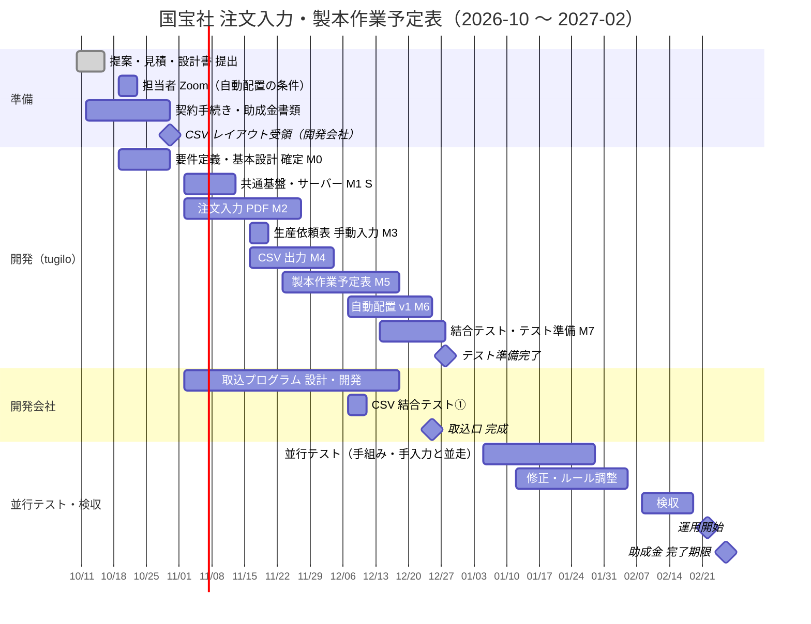

# 株式会社国宝社 様 — スケジュール表（v3・案）

**作成:** 2026-10-10 07:19 JST  
**位置づけ:** 第4回 1to1（2026-10-05）で合わせた「10〜12月開発・12月末テスト準備完了・1月並行テスト・2月検収」を週単位にしたもの。**計画であり契約ではない。** 助成金（板橋区 デジタル化・データ利活用推進助成金 業務管理システムコース。採択未確定）の採択・契約の時期で前後する。  
**関連:** [改訂提案書 v3](kimura_kokuhosha_proposal_v3_20261010.md) · [機能別見積](kimura_kokuhosha_estimate_v3_20261010.md) · [基本設計書](kimura_kokuhosha_basic_design_20261010.md)

---

## 1. 全体

---

## 2. 週別

| 週 | tugilo | 国宝社様 | 開発会社 | 成果・確認 |
|----|--------|----------|----------|------------|
| 10/12（月）〜 | 提案書 v3・見積・構成図・基本設計・仕様・本表を提出。質問を受ける | 内容確認。助成金の必要書類の粒度を役所に確認 | — | 文書一式 |
| 10/19〜 | **担当者 Zoom**（予定組み・事務）。自動配置の条件、稼働枠、優先度、主要1社の PDF を聞く。M0 着手 | Zoom 参加。予定表 Excel 実ファイル・PDF サンプル追加 | CSV レイアウト設計 | ヒアリング記録 |
| 10/26〜 | M0: 基本設計・仕様の確定版。置き場所（案A／B）を決める | 契約手続き。既定フォルダの場所決め | **CSV レイアウト提示（10/30 目標）** | 確定版 設計書・レイアウト |
| 11/2〜 | M1 共通基盤。S サーバー構築着手。M2 PDF 解析着手 | サーバー（Hyper-V または専用PC）の用意 | 取込プログラム 設計 | 開発環境・ログイン |
| 11/9〜 | M1・S 完了。M2 解析・項目欄 | Oracle 読み取りアカウント（使う場合） | 取込プログラム 開発 | 社内 URL で画面が開く |
| 11/16〜 | M2 承認・次へ。M3 手動入力。M4 CSV 出力着手 | 得意先の照合方法を開発会社と確認 | 取込プログラム 開発 | PDF 1件が承認まで通る |
| 11/23〜 | M2 完了。M4 継続。M5 予定表着手 | 通知方法・UPDATE／DELETE を開発会社と確認 | 取込プログラム 開発 | 承認 → CSV ファイルが出る |
| 11/30〜 | M4 完了（結果ファイル対応は方式確定後）。M5 予定表 | — | 取込プログラム 開発 | CSV を開発会社に送る |
| 12/7〜 | M5 予定表（差し込み・作業時間・合計）。M6 自動配置着手。**結合テスト①** | 結合テスト立会 | **結合テスト①**（CSV → Oracle） | 1件が Oracle に入る |
| 12/14〜 | M5 完了。M6 ルール実装。M7 結合テスト | 予定表の試し触り | 修正 | 予定表で週が組める |
| 12/21〜 | M6 完了。M7 テスト・操作メモ | 並行テストの体制（誰が・いつ比べるか） | **取込口 完成（12/25 目標）** | 自動配置ボタンが提案を出す |
| 12/28〜 | **テスト準備完了（12/28）**。年末 | 年末 | 年末 | テスト環境・操作メモ |
| 1/5（月）〜 | **並行テスト開始。** 週1回の見直し（火曜 1h・Zoom） | 現行の手入力・手組みと **並走**。PDF を Web にも通す。予定表を Web でも組む | 取込を実運用手順で実行 | 差分一覧 |
| 1/12〜 | 並行テスト。解析の直し、ルールの重み調整 | 並走。差の理由を拾う | 取込結果の確認 | 週次 差分 |
| 1/18〜 | 並行テスト。修正 | 並走 | — | 週次 差分 |
| 1/25〜 | 並行テスト 締め。時間の実測（手入力・予定組み） | 並走。実測に協力 | — | **実測値**（ROI 置き換え） |
| 2/1〜 | 修正の最終。検収項目表 | 検収項目の確認 | — | 検収項目表 |
| 2/8〜 | **検収**。引き渡し手順・バックアップ手順 | 検収 | 取込口の引き渡し | 検収書 |
| 2/15〜 | 検収 修正。運用開始準備 | 運用体制 | — | — |
| 2/22（月） | **運用開始**。立会 | 運用開始 | — | — |
| 2/26（金） | — | **助成金 完了報告（期限 2/28）** | — | 完了報告 |

---

## 3. マイルストーン

| 日 | 内容 | 条件 |
|----|------|------|
| 10/16（金） | 文書一式 提出 | 本 Phase |
| 10/23（金） | 担当者 Zoom 完了 | 日程調整 |
| 10/30（金） | CSV レイアウト受領、契約手続き、置き場所決定 | 開発会社・助成金 |
| 12/11（金） | 結合テスト①（CSV → Oracle 1件） | 開発会社の取込口 試作 |
| 12/25（金） | 取込口 完成 | 開発会社 |
| 12/28（月） | テスト準備完了 | tugilo |
| 1/5（火） | 並行テスト開始 | 体制 |
| 1/29（金） | 並行テスト 締め・実測 | — |
| 2/19（金） | 検収 | — |
| 2/22（月） | 運用開始 | — |
| 2/28（日） | 助成金 完了期限 | 国宝社様 |

---

## 4. 前提と遅れ要因

| 前提 | 遅れると |
|------|----------|
| 10/30 までに CSV レイアウト受領 | M4 の確定が遅れる。tugilo は「たたき台」で先に作り、提示後に合わせる |
| 10月中に契約手続き（採択の確約ではない） | 11/2 着手がずれ、同じ日数だけ後ろへ。2/28 を越える場合は範囲（あれば便利）で調整 |
| 11月中にサーバー（Hyper-V の空き or 専用PC） | M1・S が後ろへ。開発はローカルで進め、配置だけ後ろにできる |
| 12/25 に取込口完成 | 1月の並行テストで Oracle まで通せない。CSV まで並走し、取込だけ後追い |
| 1月に並走の体制（事務・予定組み担当） | 実測が取れない。2月の検収は機能ベースで行い、実測は運用開始後 |
| 予定表 Excel 実ファイル・PDF サンプル追加（10月） | 解析・予定表のカード項目の確定が遅れる |

---

## 5. 会議体

| 会 | 頻度 | 参加 | 目的 |
|----|------|------|------|
| 木村さん 1to1（Zoom） | 2週に1回・40分 | 木村さん・次廣 | 進捗・判断 |
| 担当者ヒアリング | 10月に1回 | 予定組み・事務・木村さん・次廣 | 自動配置条件・PDF |
| 開発会社 連携確認 | 10月末・11月中・12月結合時 | 開発会社・木村さん・次廣 | レイアウト・通知・テスト |
| 並行テスト見直し | 1月 週1回・1時間 | 事務・予定組み・木村さん・次廣 | 差分・修正 |
