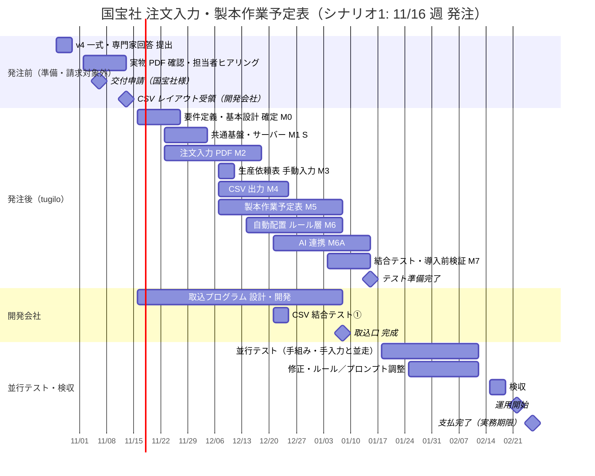

# 株式会社国宝社 様 — スケジュール表（v4・案）

> **【2026-10-26 13:30 JST 追記・重要】第5回打合せの最後に木村さんと「今回は AI は不要」で決定。** 本書の AI 連携（三層・M6A ¥250,000・送信制御等）は **今回の開発対象外**。正式見積は [v3](kimura_kokuhosha_estimate_v3_20261010.md) の必須 ¥2,650,000（AI は任意 O4 のまま）を基準に、第5回で判明した新要件（複数ページ PDF・再発行の差分検知・製本日入力・まとめ製本の判断・週／月切替）を加えて作成する。→ **作成済み: [提案書 v5](kimura_kokuhosha_proposal_v5_20261026.md)・[正式見積書 v5（案）](kimura_kokuhosha_estimate_v5_20261026.md)（2026-10-26 13:50 JST・送付前）。** 本書は **AI を入れる場合の参考案**として保持。

**作成:** 2026-10-26 09:35 JST  
**位置づけ:** [v3（2026-10-10）](kimura_kokuhosha_schedule_20261010.md) の「10月契約・11/2 着手・12/28 テスト準備完了・1月並行テスト・2/19 検収」は **過去の計画であり、実施していない**（2026-10-26 時点で契約・発注・着手のいずれも無し）。本書は **発注可能時期を起点に引き直した再調整案**。**計画であり契約ではない。** 助成金の交付申請（提出目安 11月上旬・専門家シート）→ 交付決定 → 発注、という順を前提にし、**2027-02-28 までに納品・検収・支払いを終える**ことを固定条件とする。  
**関連:** [提案書 v4](kimura_kokuhosha_proposal_v4_20261026.md) · [見積 v4](kimura_kokuhosha_estimate_v4_20261026.md) · [基本設計 v4](kimura_kokuhosha_basic_design_v4_20261026.md)

> **確認が要ること（過去資料で確定させない）:** ①交付決定前の着手・契約が認められるか ②交付決定の見込み時期 ③発注可能日 ④CSV レイアウトの提示時期（v3 の 10/30 目標は未達）⑤既存会社の取込口の完成見込み。①〜③は専門家・公社、④⑤は開発会社。

---

## 1. 発注前にできること（契約・請求の対象にしない）

| 時期 | tugilo | 国宝社様 | 開発会社 | 専門家・公社 |
|------|--------|----------|----------|--------------|
| 10/26〜 | v4 一式・専門家シート回答の提出。実物 PDF のテキスト層確認（受領次第） | 実物 PDF 数件の提供。AI の使いどころ（順番案まで／定型の指示まで）の意向確認。担当者ヒアリングの日程 | CSV レイアウト設計 | 専門家打合せ（日程調整中） |
| 11月上旬 | 担当者ヒアリング（自動配置の条件・稼働枠・適性・優先度・PDF）。基本設計・仕様の確定案 | 交付申請（提出目安 11月上旬） | CSV レイアウト提示 | 申請受理 |
| 交付決定まで | 正式見積（作業項目×人日×単価）、選定理由書たたき台、納品物一覧、契約書案の準備 | 置き場所の決定。AI API アカウント（名義）の段取り | 取込プログラムの見積・工程 | 交付決定 |

- この期間の tugilo の作業は **準備**であり、契約・発注・請求の対象にしない（採択前に契約・発注した扱いにしないため）。扱いは次廣確認事項

---

## 2. 発注時期ごとのシナリオ（2/28 支払完了を固定）

| | シナリオ1 | シナリオ2 | シナリオ3 |
|---|---|---|---|
| **発注・契約** | **11/16（月）週** | **11/30（月）週** | **12/14（月）週以降** |
| 要件定義 M0 | 11/16〜11/27 | 11/30〜12/11 | 12/14〜12/25 |
| 開発 M1〜M6A・S | 11/23〜1/15（約8週・年末年始除く） | 12/7〜1/22（約6週・年末年始除く） | 12/21〜1/29（約5週・年末年始除く） |
| 開発会社 結合テスト① | 12/21 週 | 1/4 週 | 1/11 週 |
| テスト準備完了 | **1/15（金）** | **1/22（金）** | **1/29（金）** |
| 並行テスト | **1/18〜2/12（4週）** | **1/25〜2/12（3週）** | **2/1〜2/12（2週）** |
| 検収 | 2/15〜2/19（金） | 2/15〜2/19 | 2/15〜2/19 |
| 運用開始 | 2/22（月） | 2/22 | 2/22 |
| 請求・支払 | 2/19 請求 → **2/26（金）までに支払** | 同左 | 同左 |
| **実現性** | v3 と同じ範囲で可能。並行テスト 4 週を確保 | **範囲調整が要る**（§3）。並行テスト 3 週 | **困難。** 専門家・公社に期限・範囲を相談（§3） |

- 2/28 は日曜のため、支払完了の実務上の期限を **2/26（金）** と置く（公社の扱いは要確認）
- 年末年始（12/29〜1/3）は開発会社・国宝社様とも休みと仮定

---

## 3. シナリオ2・3 での範囲調整案（次廣・国宝社様で判断）

| 調整 | 内容 | 影響 |
|------|------|------|
| A | 言葉での指示（F-17）を定型範囲に限定（見積 v4 §5.1 案A） | 工数の揺れを抑える。シナリオ1 でもこの前提 |
| B | 任意（O1〜O6）は一切入れない | 変更なし（v3 から任意は後回し） |
| C | 並行テストを 3 週→2 週に短縮し、検収指標（仕様 v4 §10）の週数を読み替える | 実測の精度が下がる。検収は機能ベース中心 |
| D | 取込口が間に合わない場合、並行テストは CSV 出力まで並走し、Oracle 取込は後追い | 検収 (d) を後日に分ける |
| E | PDF が画像のみと判明した場合、機能1 は「手動入力＋PDF プレビュー」で検収し、解析方式（OCR／帳票読取 AI）は別途 | M2 の範囲・金額を見直す |
| F | シナリオ3 で 2/28 に収まらない場合: 機能1（注文入力＋CSV）を先行検収し、予定表を次年度に分ける、または期限の扱いを公社に相談 | 助成対象の範囲・申請内容に関わるため **専門家・公社と要相談** |

---

## 4. 全体（シナリオ1 の場合）

---

## 5. 週別（シナリオ1）

| 週 | tugilo | 国宝社様 | 開発会社 | 成果・確認 |
|----|--------|----------|----------|------------|
| 10/26〜 | v4 一式・専門家シート回答を提出。実物 PDF の確認（受領次第） | 実物 PDF の提供。AI の使いどころの意向。専門家打合せ日程 | CSV レイアウト設計 | 文書一式。PDF 方式の判定 |
| 11/2〜 | **担当者ヒアリング**（稼働枠・適性・優先度・PDF・指示の範囲）。基本設計・仕様の確定案 | ヒアリング参加。予定表 Excel 実ファイル。交付申請（上旬） | — | ヒアリング記録 |
| 11/9〜 | 正式見積（人日×単価）・選定理由書たたき台・納品物一覧・契約書案 | 置き場所決定。AI アカウント名義の段取り | **CSV レイアウト提示（11/13 目標）** | 正式見積 |
| 11/16〜 | **発注（想定）。** M0 要件定義着手 | 契約。既定フォルダの場所決め | 取込プログラム 設計着手 | 契約 |
| 11/23〜 | M0 確定。M1 共通基盤・S サーバー着手。M2 PDF 解析着手 | サーバーの用意（Hyper-V または専用PC）。FW 外向き許可の相談 | 取込プログラム 開発 | 開発環境・ログイン |
| 11/30〜 | M1・S 完了。M2 解析・項目欄 | Oracle 読み取りアカウント（使う場合）。AI API アカウント作成 | 開発 | 社内 URL で画面が開く |
| 12/7〜 | M2 承認・次へ。M3 手動入力。M4 CSV 出力着手。M5 予定表着手 | 得意先の照合方法を開発会社と確認 | 開発 | PDF 1件が承認まで通る |
| 12/14〜 | M2 完了。M4 継続。M5 予定表。M6 ルール層着手 | 通知方法・UPDATE／DELETE・重複防止を開発会社と確認 | 開発 | 承認 → CSV が出る |
| 12/21〜 | M4 完了。M5・M6 継続。**M6A AI 連携着手**（送信制御・検証・切替から）。**結合テスト①** | 結合テスト立会 | **結合テスト①**（CSV → Oracle 1件） | 1件が Oracle に入る |
| 12/28〜 | 年末年始 | 年末年始 | 年末年始 | — |
| 1/4〜 | M5・M6 完了。M6A（案・理由・修正例参照・設定画面）。M7 結合テスト着手 | 予定表の試し触り。並行テストの体制 | 修正。**取込口 完成（1/8 目標）** | 予定表で週が組める。ルール案が出る |
| 1/11〜 | M6A 完了。M7 **導入前検証**（送信内容・権限・ログ・切替）。操作説明書 | 検証の立会（送信内容の確認） | — | **テスト準備完了（1/15）**。検証記録 |
| 1/18〜 | **並行テスト開始。** 週1回の見直し | 現行と **並走**。PDF を Web にも通す。予定表を Web でも組む | 取込を実運用手順で実行 | 差分一覧 |
| 1/25〜 | 並行テスト。解析の直し、ルール・プロンプトの調整。AI 案／ルール案の比較記録 | 並走。差の理由を拾う | 取込結果の確認 | 週次 差分 |
| 2/1〜 | 並行テスト。修正 | 並走 | — | 週次 差分 |
| 2/8〜 | 並行テスト 締め（2/12）。時間の実測。検収項目表 | 並走。実測に協力。検収項目の確認 | — | 実測値。検収項目表 |
| 2/15〜 | **検収（〜2/19）**。引き渡し・手順書・納品物。請求 | 検収。検収書 | 取込口の引き渡し | 検収書・納品物 |
| 2/22（月） | **運用開始**。立会 | 運用開始 | — | — |
| 2/26（金） | — | **支払完了・完了報告（期限 2/28）** | — | 完了報告 |

---

## 6. マイルストーン（シナリオ1）

| 日 | 内容 | 条件 |
|----|------|------|
| 10/30（金） | v4 一式・専門家回答 提出 | 本版 |
| 11/13（金） | 担当者ヒアリング完了、CSV レイアウト受領、実物 PDF 方式判定 | 国宝社様・開発会社 |
| 11月上旬 | 交付申請（国宝社様） | 専門家 |
| **11/16（月）週** | **発注・契約**（想定。交付決定の時期で前後） | 公社 |
| 12/25（金） | 結合テスト①（CSV → Oracle 1件） | 開発会社の取込口 試作 |
| 1/8（金） | 取込口 完成 | 開発会社 |
| 1/15（金） | テスト準備完了・導入前検証 | tugilo |
| 1/18（月） | 並行テスト開始 | 体制 |
| 2/12（金） | 並行テスト 締め・実測 | — |
| 2/19（金） | 検収・請求 | — |
| 2/22（月） | 運用開始 | — |
| 2/26（金） | 支払完了（実務期限） | 国宝社様 |
| 2/28（日） | 助成金 完了期限 | 国宝社様 |

---

## 7. 前提と遅れ要因

| 前提 | 遅れると |
|------|----------|
| 交付決定前の着手の可否と、交付決定の時期（専門家・公社） | 発注が後ろへ → シナリオ2・3 へ。範囲調整（§3） |
| 11/13 までに CSV レイアウト受領 | M4 の確定が遅れる。たたき台で先に作り、提示後に合わせる |
| 実物 PDF にテキスト層がある | 無ければ M2 の方式変更（§3-E）。別費用・別日程 |
| 11月中に担当者ヒアリング（稼働枠・適性・優先度・指示の範囲） | M6・M6A の設計が遅れる。既定値で作って並行テストで直す |
| 11月末までにサーバー（Hyper-V の空き or 専用PC）と FW の外向き許可 | M1・S・M6A が後ろへ。開発はローカルで進め、配置だけ後ろにできる |
| 12月中に AI API アカウント（国宝社様名義） | M6A の実送信テストができない。tugilo の検証用で先に作り、切り替える |
| 1/8 に取込口完成 | 並行テストで Oracle まで通せない。CSV まで並走し、取込だけ後追い（§3-D） |
| 1月に並走の体制（事務・予定組み担当） | 実測が取れない。検収は機能ベースで行い、実測は運用開始後 |

---

## 8. 会議体

| 会 | 頻度 | 参加 | 目的 |
|----|------|------|------|
| 木村様 1to1（Zoom） | 2週に1回・40分 | 木村様・次廣 | 進捗・判断 |
| 専門家打合せ | 11月に1回（日程調整中） | 花村氏・木村様・次廣（公社同席は要確認） | 25観点・ヒアリングシート・申請書類との整合 |
| 担当者ヒアリング | 11月上旬に1回 | 予定組み・事務・木村様・次廣 | 自動配置条件・PDF・指示の範囲 |
| 開発会社 連携確認 | レイアウト提示時・発注後 2 週・結合時 | 開発会社・木村様・次廣 | レイアウト・通知・重複防止・テスト |
| 導入前検証 立会 | 1月中旬に1回 | 木村様・次廣 | AI 送信内容・権限・ログ・切替の確認 |
| 並行テスト見直し | 週1回・1時間 | 事務・予定組み・木村様・次廣 | 差分・修正 |
