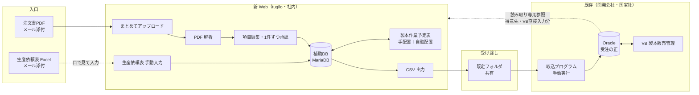
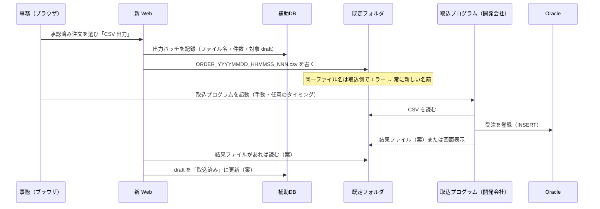
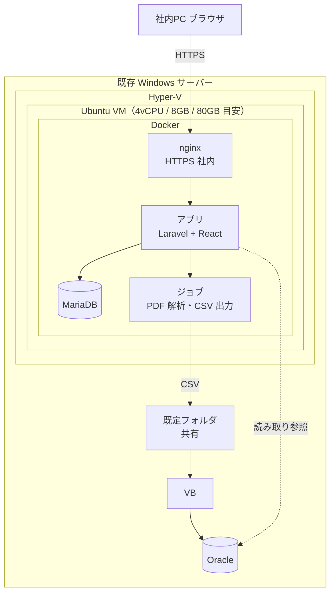
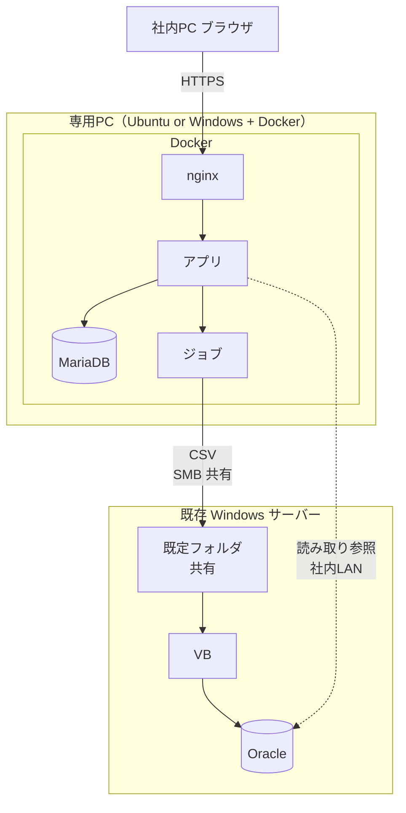
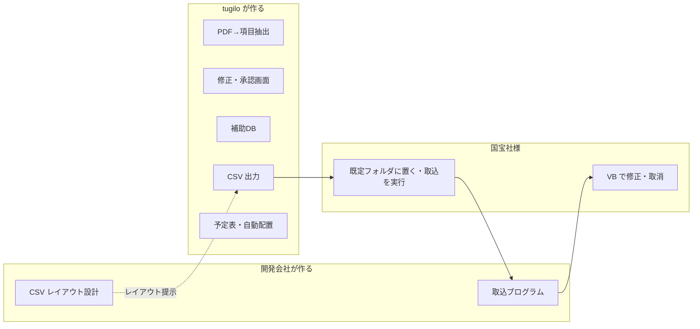

# 株式会社国宝社 様 — システム構成図（v3）

**作成:** 2026-10-10 07:19 JST  
**位置づけ:** 第4回 1to1（2026-10-05）合意と、既存システム開発会社の「注文データ取込プログラム ご要望事項イメージ図」（2026-09-29）に合わせた構成。案。  
**関連:** [改訂提案書 v3](kimura_kokuhosha_proposal_v3_20261010.md) · [基本設計書](kimura_kokuhosha_basic_design_20261010.md) · [仕様書](kimura_kokuhosha_specification_20261010.md)

---

## 1. 全体像（データの流れ）

- **tugilo 範囲:** 入口（PDF／手動入力）、補助DB、注文情報修正画面、予定表、CSV 出力
- **開発会社 範囲:** CSV レイアウト設計・提示、取込プログラム、Oracle への登録
- **国宝社様:** 既定フォルダに置かれた CSV を見て、取込プログラムを実行（手動）
- 補助DB は正にしない。受注・得意先・注文番号の正は Oracle のまま
- Oracle への **書き込みは無い**。読み取りは、得意先の参照と、予定表に VB で直接入力された注文を出すために使う（点線。要確認。使わない場合は開発会社から得意先・受注一覧の CSV を受ける案）

---

## 2. CSV 連携の約束事（開発会社資料に合わせる）

- 連携は **CSV 等のテキスト**。手動実行。既定フォルダ。同一ファイル名は重複エラー
- **取込結果の通知**と **UPDATE／DELETE の有無**は開発会社の確認事項。tugilo 案は [基本設計書 §6](kimura_kokuhosha_basic_design_20261010.md)

---

## 3. 配置（置き場所）

### 案A — 既存 Windows の Hyper-V に Ubuntu を1台

- 利点: 新しい機械が要らない。既定フォルダが同じ機械
- 条件: Hyper-V に VM 1台分の空きがあること（要確認）

### 案B — 専用PC（木村さん所有・16GB・SSD）

- 利点: Oracle と別の機械。既存サーバーの負荷を増やさない（木村さんの意向）
- 条件: 既定フォルダへ SMB 等で書けること。PC の常時稼働・UPS

**両案共通:** 外部公開なし。Google Workspace／GAS 不採用。社内 LAN のみ。バックアップは DB ダンプ＋アップロード PDF を日次でサーバー側へ。

---

## 4. 中身（アプリの層）

| 層 | 内容 | 技術（案） |
|----|------|------------|
| 画面 | 注文入力・生産依頼表入力・予定表・CSV 出力・管理 | React（画面見本と同じ操作） |
| アプリ | 認証・権限・解析・承認・CSV 生成・自動配置ルール・ログ | Laravel |
| ジョブ | PDF 解析（1件ずつ、「次へ」で次を実行）、CSV 書き出し、（あれば便利）メール取込 | キュー |
| 補助DB | ユーザー・draft・解析証跡・予定表・出力履歴 | MariaDB |
| ファイル | アップロード PDF 原本、CSV 控え | ローカルディスク（バックアップ対象） |
| 外部参照 | 得意先・VB 直接入力分の読み取り | Oracle 読み取り専用接続（要確認） |

---

## 5. 開発会社との境界

境界は **既定フォルダの CSV**。ここが決まれば両側は独立に進められる。
