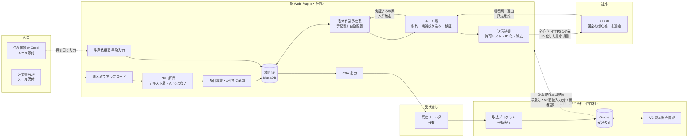
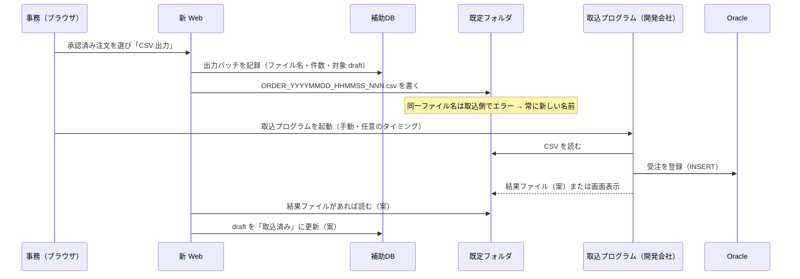
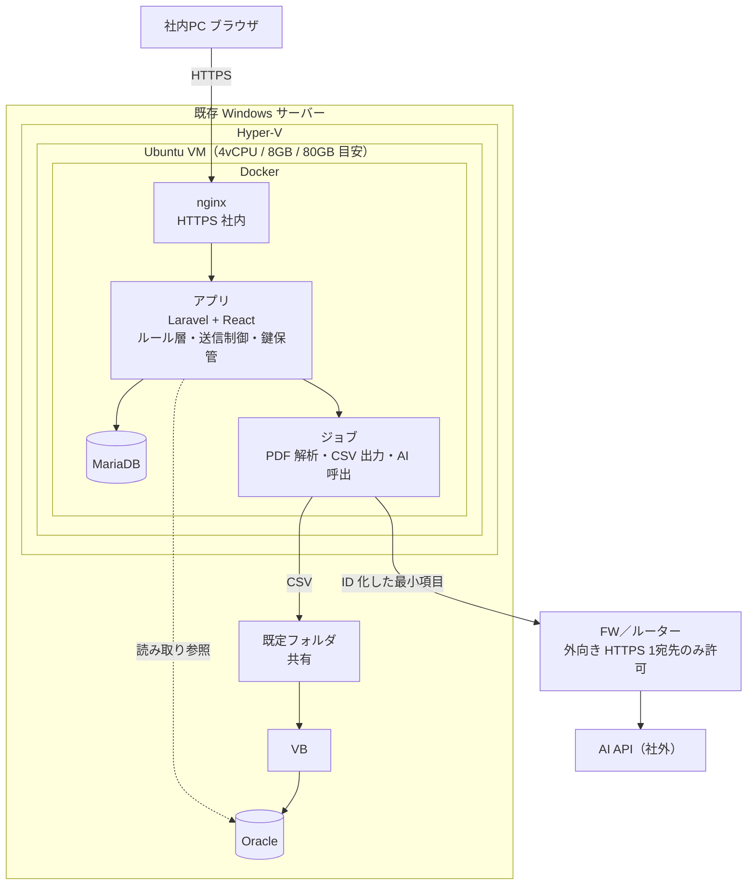
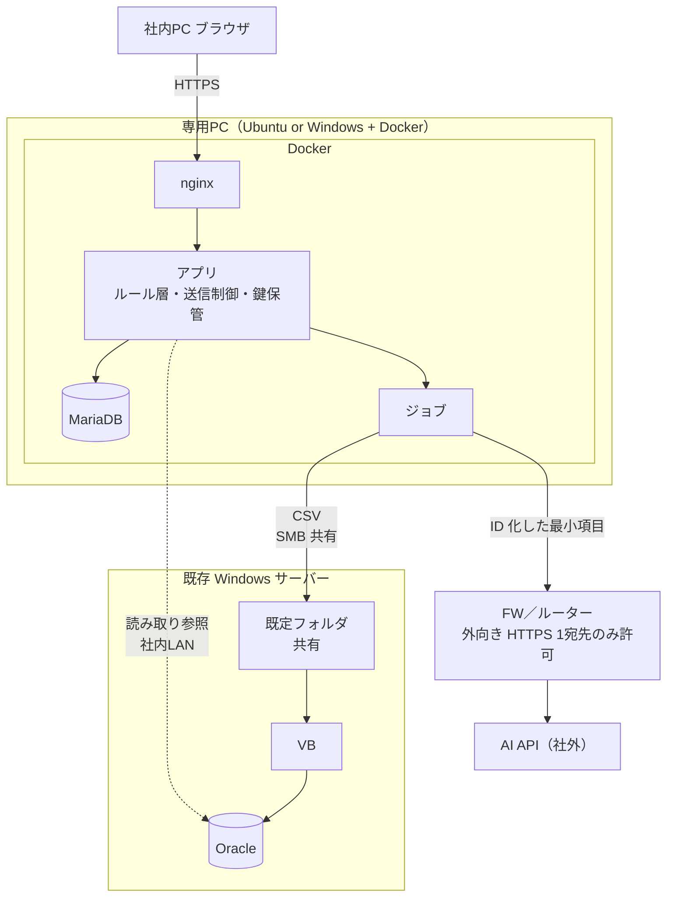
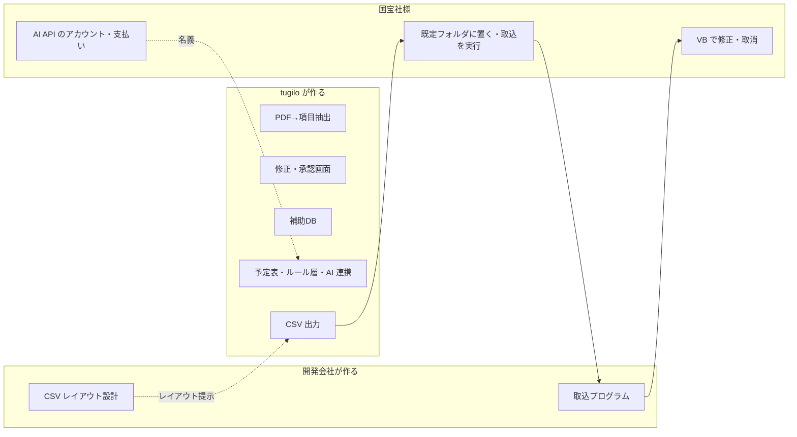
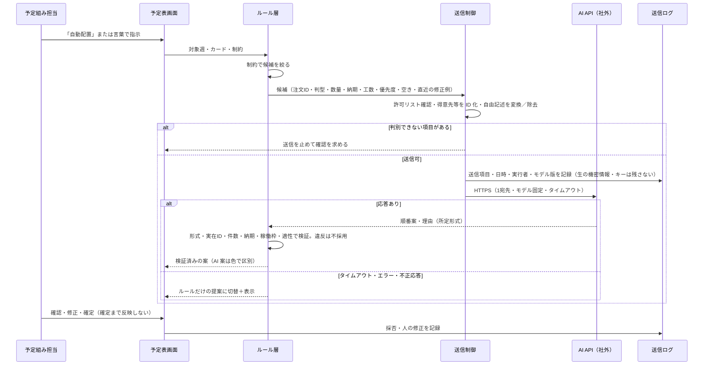

# 株式会社国宝社 様 — システム構成図（v4）

> **【2026-10-26 13:30 JST 追記・重要】第5回打合せの最後に木村さんと「今回は AI は不要」で決定。** 本書の AI 連携（三層・M6A ¥250,000・送信制御等）は **今回の開発対象外**。正式見積は [v3](kimura_kokuhosha_estimate_v3_20261010.md) の必須 ¥2,650,000（AI は任意 O4 のまま）を基準に、第5回で判明した新要件（複数ページ PDF・再発行の差分検知・製本日入力・まとめ製本の判断・週／月切替）を加えて作成する。→ **作成済み: [提案書 v5](kimura_kokuhosha_proposal_v5_20261026.md)・[正式見積書 v5（案）](kimura_kokuhosha_estimate_v5_20261026.md)（2026-10-26 13:50 JST・送付前）。** 本書は **AI を入れる場合の参考案**として保持。

**作成:** 2026-10-26 09:35 JST  
**位置づけ:** [v3（2026-10-10）](kimura_kokuhosha_system_architecture_20261010.md) に、**予定表の AI 連携（外部 AI API への外向き通信）** と **送信情報の制御・鍵管理の位置** を加えたもの。案。実装・検証はこれから。  
**関連:** [提案書 v4](kimura_kokuhosha_proposal_v4_20261026.md) · [基本設計 v4](kimura_kokuhosha_basic_design_v4_20261026.md) · [仕様 v4](kimura_kokuhosha_specification_v4_20261026.md)

> **v3 からの変更:** §1 に AI API への経路と送信制御（許可リスト・ID 化）を追加。§3 両案に「外向き HTTPS 1 宛先」を追加。§4 に AI 連携層・鍵保管・送信ログを追加。§6（新設）AI 連携の経路と守り。CSV 連携・置き場所の2案・開発会社との境界は変更なし。

---

## 1. 全体像（データの流れ）

- **tugilo 範囲:** 入口（PDF／手動入力）、補助DB、注文情報修正画面、予定表、ルール層、AI 連携（送信制御・検証・切替）、CSV 出力
- **開発会社 範囲:** CSV レイアウト設計・提示（**未受領**）、取込プログラム、Oracle への登録
- **国宝社様:** 既定フォルダに置かれた CSV を見て、取込プログラムを実行（手動）。AI API のアカウント・支払い（名義）
- 補助DB は正にしない。受注・得意先・注文番号の正は Oracle のまま
- Oracle への **書き込みは無い**。読み取りは、得意先の参照と、予定表に VB で直接入力された注文を出すために使う（点線。要確認。使わない場合は開発会社から得意先・受注一覧の CSV を受ける案）
- **AI API への通信は、ルール層が絞った候補を送信制御（GUARD）が ID 化・許可リスト化してから**。返答はルール層が検証し、人が確定するまで予定表に反映しない。AI が止まればルール層だけで提案する

---

## 2. CSV 連携の約束事（開発会社資料に合わせる・変更なし）

- 連携は **CSV 等のテキスト**。手動実行。既定フォルダ。同一ファイル名は重複エラー
- **取込結果の通知**、**UPDATE／DELETE の有無**、**文字コード**、**再取込時の重複防止**、**得意先コードの照合**は開発会社への確認事項。tugilo 案は [基本設計 v4 §6](kimura_kokuhosha_basic_design_v4_20261026.md)

---

## 3. 配置（置き場所）

### 案A — 既存 Windows の Hyper-V に Ubuntu を1台

- 利点: 新しい機械が要らない。既定フォルダが同じ機械
- 条件: Hyper-V に VM 1台分の空きがあること（要確認）。FW で外向き HTTPS の宛先を AI API に限定できること

### 案B — 専用PC（木村様所有・16GB・SSD）

- 利点: Oracle と別の機械。既存サーバーの負荷を増やさない（木村様の意向）
- 条件: 既定フォルダへ SMB 等で書けること。PC の常時稼働・UPS。FW の外向き制限

**両案共通:** 外からの受け付けなし（公開しない）。**外向き通信は AI API への HTTPS 1 宛先のみ**（送信先は国宝社様が承認）。Google Workspace／GAS 不採用。バックアップは DB ダンプ＋アップロード PDF＋CSV 控えを日次でサーバー側へ（バックアップにも API キー・生の機密情報を残さない）。

---

## 4. 中身（アプリの層）

| 層 | 内容 | 技術（案） |
|----|------|------------|
| 画面 | 注文入力・生産依頼表入力・予定表・自動配置の提案確認・言葉での指示欄・CSV 出力・管理（AI 設定を含む） | React（画面見本と同じ操作） |
| アプリ | 認証・権限・解析・承認・CSV 生成・**ルール層（制約・候補・検証・切替）**・ログ | Laravel |
| **AI 連携** | **送信制御**（許可リスト・ID 化・自由記述の変換／除去・停止）、API 呼出（モデル固定・タイムアウト）、**出力検証**、**異常時のルール切替**、**送信ログ**、プロンプト版管理 | Laravel（既存の AI 連携基盤を型として流用。検証・切替・送信制御は本件で新規） |
| ジョブ | PDF 解析（1件ずつ）、CSV 書き出し、AI 呼出（週次・再提案）、（任意）メール取込 | キュー |
| 補助DB | ユーザー・draft・解析証跡・予定表・出力履歴・配置提案・修正履歴・**ID 対応表**・プロンプト版・送信ログ | MariaDB |
| 鍵・設定 | **API キーはサーバー側で暗号化保管**（画面・ソース・通常ログに出さない）。モデル名・送信先・許可リストは設定 | Laravel 暗号化カラム＋環境設定 |
| ファイル | アップロード PDF 原本、CSV 控え | ローカルディスク（バックアップ対象。**外部に送らない**） |
| 外部参照 | 得意先・VB 直接入力分の読み取り | Oracle 読み取り専用接続（要確認） |
| 外部送信 | AI API（国宝社様名義・未選定） | HTTPS（証明書検証）。1 宛先 |

---

## 5. 開発会社との境界（変更なし）

境界は **既定フォルダの CSV**。ここが決まれば両側は独立に進められる。

---

## 6. AI 連携の経路と守り（設計方針。実装・検証予定）

| 観点 | 方針 |
|------|------|
| 送る | 注文ID・判型・数量・納期・予定工数・優先度・空き状況・直近の修正例（ID 化） |
| 送らない | 氏名・住所・連絡先・金額・書名・PDF 原本。得意先名は ID。対応表は社内 |
| 鍵 | サーバー側で暗号化保管。最小権限。失効・再発行手順 |
| AI の権限 | DB 接続・任意ファイル参照・更新実行の権限を直接与えない |
| 異常時 | 通信停止 → キー失効 → 影響確認 → 国宝社様へ連絡 → ルール運用へ切替 |
| 言い切らない | ID 化後も数量・納期は業務情報。完全匿名・リスクゼロとは表現しない |
| サービス条件 | 学習不使用と保存なしは別（OpenAI は既定で学習不使用・監視ログ最長30日・保持なしは事前承認制。2026-10-26 公式ページ確認）。他社は個別確認 |
| 帳票読取 AI を足す場合 | 原本送信を伴うため、配置用 AI とは **別の経路・別の契約条件・別の費用**として整理（本図には含めない） |
